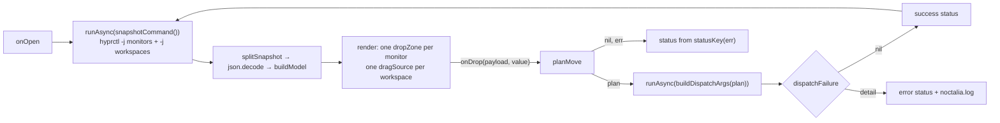

<div align="center">

# Workspace DnD

**A [Noctalia](https://noctalia.dev) plugin that lets you drag a Hyprland workspace
from one monitor to another — pick up the number and drop it on the other screen.**


</div>

---

## Why this exists

Noctalia's built-in `workspaces` widget lets you *click* a workspace, but it cannot
*move* one to another monitor, and no plugin in the official or community catalogue
does either. Switching monitors usually means a keybind.

This plugin gives you the gesture you actually want:

```
╭─ Воркспейсы ───────────────────────────────────── ⟳    ✕ ╮
│                                                          │
│  ┌─ HDMI-A-1 ────────── 2560×1440 ─┐ ┌─ DP-2 ────────┐  │
│  │  ≡  #1   ·1                     │ │  ≡  #6   ·2   │  │
│  │  ≡  #2   ·5   ◀── drag ───┐     │ │               │  │
│  │  ≡  #3   ·1               └─────┼─▶  drop here    │  │
│  │  ≡  #4   ·3                     │ │               │  │
│  └─────────────────────────────────┘ └───────────────┘  │
│  Воркспейс 2 → DP-2                                      │
╰──────────────────────────────────────────────────────────╯
```

Grab the grip handle next to a workspace, drop it on the other monitor's column,
and the workspace (with all its windows) moves there.

## Features

- **Real drag & drop** of a workspace between monitors, inside a Noctalia panel.
- **One column per monitor**, workspaces grouped exactly where the compositor says they are.
- **Workspace number, window count, and an active-workspace highlight** on every row.
- **Named workspaces** show their name next to the number.
- **Inline feedback** — success, "already on this monitor", and full compositor errors
  are reported in the panel's status line (and written to the Noctalia log on failure).
- **Bilingual** out of the box (English, Russian).
- **No periodic polling of your config, no surprises**: the compositor is queried once
  per refresh with a single static shell command, and the move is dispatched through
  `hyprctl` with an **argument array** (never a shell string).

## Requirements

| Requirement | Notes |
| --- | --- |
| Noctalia v5 | Plugin API **26** or newer (`noctalia msg plugins list` shows the supported range). |
| Hyprland with the **Lua dispatcher API** | The move uses `hl.dsp.workspace.move({ … })`. Verified on Hyprland 0.56.2 with a Lua config. |
| `hyprctl` | Must be on `PATH` (declared in `dependencies`). |
| `luajit` | Only to run the test suite; not needed at runtime. |

> **Compatibility note.** On Hyprland builds that run a **Lua config**, legacy
> dispatchers no longer exist — `hyprctl dispatch moveworkspacetomonitor 2 DP-2` is
> rewritten to `return hl.dispatch(moveworkspacetomonitor 2 DP-2)` and fails to parse.
> This plugin therefore dispatches the Lua form. On a classic (non-Lua) Hyprland build
> the move fails and the compositor's own error text is shown in the panel's status
> line; see [Limitations](#limitations).

## Installation

### 1. Add the plugin source and enable the plugin

```sh
noctalia msg plugins source add workspace-dnd git https://github.com/thegalkin/noctalia-workspace-dnd
noctalia msg plugins list | grep workspace-dnd
noctalia msg plugins enable thegalkin/workspace-dnd
```

### 2. Add the button to your bar

```toml
# ~/.config/noctalia/config.toml
[widget.workspace_dnd]
type = "thegalkin/workspace-dnd:open"

[bar.default]
end = ["workspace_dnd"]
```

Then reload: `noctalia msg config-reload`.

The widget is optional — you can also bind the panel directly (see below).

### Alternative: right-click the built-in workspaces widget

The `workspaces` widget reserves only `left`, so `right` is free to bind. No extra
widget on the bar is needed:

```toml
# ~/.config/noctalia/config.toml
[widget.workspaces.actions]
right = "panel-toggle thegalkin/workspace-dnd:panel"
```

Right-clicking the workspace number now opens the drag & drop panel.

### Alternative: run from a checkout (development)

A `path` source picks up your working tree and hot-reloads on every save:

```sh
git clone https://github.com/thegalkin/noctalia-workspace-dnd
noctalia msg plugins source add workspace-dnd-dev path "$PWD/noctalia-workspace-dnd"
noctalia msg plugins enable thegalkin/workspace-dnd
```

To remove any of this again:

```sh
noctalia msg plugins disable thegalkin/workspace-dnd
noctalia msg plugins source remove workspace-dnd
```

## Usage

- **Left-click** the bar button to open the panel.
- **Drag** a workspace row (grab the `≡` handle, or anywhere on the row) onto another
  monitor's column and **release**.
- **⟳** refreshes the snapshot; **✕** closes the panel.

### Keybind instead of a bar button

Panel entries can be opened over IPC, so you can skip the widget entirely:

```lua
-- Hyprland Lua config
hl.bind("SUPER + SHIFT + M", hl.dsp.exec_cmd("noctalia msg panel-toggle thegalkin/workspace-dnd:panel"))
```

```ini
# Classic Hyprland config
bind = SUPER SHIFT, M, exec, noctalia msg panel-toggle thegalkin/workspace-dnd:panel
```

### Settings

| Key | Type | Default | Description |
| --- | --- | --- | --- |
| `show_counts` | bool | `true` | Append each workspace's open-window count. |

Settings live under **Settings → Plugins → Workspace DnD**.

## How it works



1. **Snapshot** — one round-trip runs `hyprctl -j monitors` and `hyprctl -j workspaces`
   and splits the output on a literal separator line.
2. **Model** — `buildModel` drops special workspaces, groups the rest by monitor,
   sorts monitors left-to-right and workspaces by id.
3. **Render** — each monitor becomes a `ui.dropZone`, each workspace a `ui.dragSource`
   carrying a `ws:<id>` payload.
4. **Drop** — `planMove` turns `(payload, value)` into `{ workspace, monitor }`, or into
   one of `invalid-drop` / `unknown-workspace` / `unknown-monitor` / `same-monitor`.
   A valid plan is dispatched as
   `hyprctl dispatch 'hl.dsp.workspace.move({ workspace = 2, monitor = "DP-2" })'`.
5. **Verify** — a success prints exactly `ok` on **stdout** (exit `0`), while a failure prints
   `warning: …` on stdout and *still* exits `0`, so `dispatchFailure` decides success from the
   output text rather than the exit code.

### Why a panel (and not the bar)?

Noctalia only allows drag sources inside **panels** — `ui.dragSource` / `ui.dropZone`
are rejected on bar widgets, a drag never leaves a single surface, and there is no
OS/Wayland drag-and-drop. The bar therefore carries a button; the gesture happens in
the panel it opens. All monitors are represented as columns inside that one panel.

## Project layout

```
.
├── catalog.toml                 # source index (the host reads this to list the plugin)
├── workspace-dnd/               # the plugin itself (id suffix must match this dir)
│   ├── plugin.toml              # manifest: widget + panel + settings
│   ├── widget.luau              # bar button → togglePanel
│   ├── panel.luau               # the drag & drop surface (I/O + rendering)
│   ├── lib/model.luau           # pure model/logic — no I/O, unit-testable
│   └── translations/            # en, ru
├── tests/                       # black-box suites (luajit)
├── SPEC.md                      # the contract the implementation was built against
└── Makefile                     # test / package / install
```

### Architecture note

All logic that can be pure **is** pure: `lib/model.luau` performs no I/O and touches
no Noctalia global, so it is exercised by a plain Lua interpreter. `panel.luau` is
written in a Lua-5.1-compatible subset and only touches the host through injected
globals, which lets its orchestration be tested with stub `noctalia` / `ui` / `panel`
tables. `SPEC.md` is the authoritative contract; the tests were written from it
without reading the implementation.

## Development

```sh
make test       # 367 black-box assertions across three suites (luajit)
make package    # dist/workspace-dnd-1.0.0.tar.gz + SHA256SUMS
make install    # register this checkout as a Noctalia plugin source and enable it
```

There is no compile step — the plugin is Luau source. `make package` produces a
deterministic (sorted, timestamp-pinned) tarball for release artifacts.

Verified on: Noctalia 5.3.0 · Hyprland 0.56.2 (Lua config) · `luajit` 2.1.

## Security

- No network access, no credentials, no telemetry, no file writes outside Noctalia's
  own plugin state.
- The only external process is `hyprctl`, invoked with an **argument array** (never a
  shell string).
- The generated dispatcher expression is built from a **numeric** workspace id and a
  monitor name that is escaped (backslash, quote, LF, CR), so a crafted monitor name
  cannot inject Lua.

## Limitations

- **Hyprland (Lua dispatcher API) only.** Legacy-dispatcher builds fail with the
  compositor's own error text. A dual-mode fallback is a candidate for a future release.
- A workspace can only be dropped onto a monitor that currently exists.
- Special workspaces (`id <= 0`, `special:*`) are hidden and cannot be dragged.
- Dropping a workspace onto the monitor it is already on is a no-op, reported as such.
- The panel is per-output, as all Noctalia panels are; the drag happens between the
  columns *inside* the panel rather than between two physical bars.

## License

[MIT](LICENSE) © 2026 thegalkin
